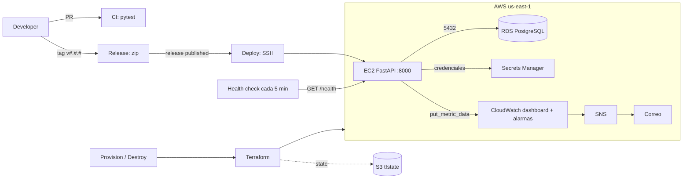

**Eduardo Antonio Pelayo Carrillo** · Desarrollo en la Nube (O2026_ESI3898K) · Práctica 4: To-Do List (CI/CD + Observabilidad) · 19 de noviembre de 2026

Repositorio: https://github.com/<usuario>/to-do-list-api

## Descripción del proyecto

to-do-list-api es un API en FastAPI para registrar tareas pendientes. Corre en una EC2 con Ubuntu y guarda las tareas en una base de datos PostgreSQL en RDS. La app no tiene credenciales en el código: al recibir una petición lee usuario, contraseña y host desde Secrets Manager.

Toda la infraestructura (EC2, Security Groups, Key Pair, RDS, secret, tópico SNS, alarmas y dashboard) se crea con Terraform desde un workflow manual de GitHub Actions, y el tfstate se guarda en un bucket de S3. Al arrancar, la EC2 corre un user_data que clona el repositorio, instala dependencias y levanta la app como servicio de systemd.

El pipeline tiene seis workflows: provisionar, destruir, CI (pruebas en cada PR, requeridas para hacer merge a main), release (una etiqueta v#.#.# genera un zip y un GitHub Release), deploy (el release nuevo se descarga en la EC2 y se reinicia el servicio, verificando con /version) y health-check (llama a /health cada 5 minutos).

Para observabilidad uso tres métricas en CloudWatch: CPUUtilization de la EC2 (nativa), RDSErrors (errores al leer o escribir en RDS) y PendingTasks (tareas con done=false), estas dos con put_metric_data. Cada una tiene una alarma que avisa por correo con SNS, y las tres están en un dashboard.

**Por qué PendingTasks:** dice cuánto trabajo queda en la lista. Si sube sin parar, se están creando tareas más rápido de lo que se terminan, o algún cliente está duplicando peticiones.

| Alarma | Condición | Por qué | Acción |
|---|---|---|---|
| CPU EC2 | Promedio > 70% en 2 periodos de 5 min | Dos periodos evitan avisar por un pico corto, como un deploy | Ver si coincide con tráfico o con un deploy; si sigue alta, revisar procesos o subir el tipo de instancia |
| RDSErrors | Suma >= 1 en 1 min | Lo normal es 0, cualquier error significa que la DB no responde | Revisar el estado de RDS y los logs del servicio |
| PendingTasks | Máximo > 20 en 5 min | Un backlog grande para una lista personal | Cerrar o priorizar tareas, buscar duplicados |

## Diagrama de arquitectura

<!-- Pega aquí la imagen del diagrama (render del bloque mermaid de abajo en https://mermaid.live) -->

## Preguntas de reflexión

**1. ¿Qué ventaja concreta notaste con Terraform?**
Como el Learner Lab se reinicia, volver a montar todo era cosa de correr un workflow y no de repetir comandos uno por uno. Lo que más trabajo me habría costado sin Terraform es conectar todo: el Security Group de RDS que solo acepta a la EC2, el secret con el endpoint real de RDS y las alarmas con el ID de la instancia nueva. Con scp yo tenía que esperar a que la instancia arrancara y copiar los archivos a mano; con user_data la instancia se configura sola al arrancar y no necesito entrar a la máquina.

**2. ¿Qué pasos manuales dejaste de hacer y qué riesgo corrías?**
Dejé de correr las pruebas a mano, de copiar el código a la EC2, de reiniciar el servidor y de revisar qué versión había quedado. Antes podía subir código sin probar o con archivos de otra versión, y no tenía forma de saber qué estaba corriendo; ahora cada deploy sale de un release con etiqueta y se verifica con /version.

**3. Una alarma: RDSErrors**
Se dispararía si RDS se detiene o se cae, por ejemplo cuando el Learner Lab apaga los recursos. En el dashboard vería que los errores suben de golpe mientras el CPU sigue normal, lo que apunta a la base de datos y no a la EC2; el /health también regresaría FAIL. La acción sería revisar el estado de RDS en la consola, volver a encenderla y confirmar que /health regresa OK y que la alarma vuelve a OK.

## Anexos

1. Dashboard de CloudWatch.
2. Alarma RDSErrors en estado In alarm (y correo de SNS).
3. tfstate en S3.
4. (Opcional) Workflows en verde, PR bloqueado, release y `curl /version`.
